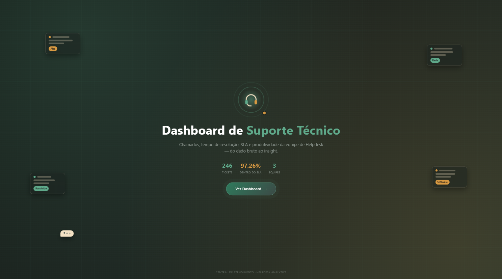

# Dashboard de Suporte Técnico (Helpdesk)

Projeto de portfólio construído para demonstrar um pipeline de dados ponta a
ponta: tratamento de dados, armazenamento relacional e análise/visualização.

Os dados são **fictícios**, gerados especificamente para este projeto.

## Objetivo

Simular a análise de uma central de suporte técnico (helpdesk): volume de
chamados, tempo de resolução, cumprimento de prazo (SLA) e produtividade por
analista — informações que uma área de TI ou operações usaria para gerenciar
sua equipe de atendimento.

## Dashboard

[Abrir o dashboard no Power BI](https://app.powerbi.com/view?r=eyJrIjoiY2I3M2JkMWYtOWM2MS00ZGQ1LTk3MmMtMDBiNDEzOGE5OGRhIiwidCI6IjI0OTQ3ZDIyLTUyYTMtNGFjNS1iZTM3LTQ2ZTVjMzUzMDFiMSJ9&pageName=22cc27f0b3eb404d1c40)



## Tecnologias utilizadas

- Python (pandas) — tratamento de dados
- SQL Server (T-SQL) — armazenamento e modelagem relacional
- Python (pyodbc, sqlalchemy) — carga dos dados tratados no banco
- Power BI + DAX — medidas de negócio e dashboard

## Pipeline

```
tickets_bruto.csv (dado sujo)          analistas.csv (gerado manualmente)
        |                                       |
        v                                       |
 limpeza com pandas                             |
        |                                       |
        v                                       v
tickets_limpos.csv  ------------------->  carga no banco
                                                 |
                                                 v
                                   SQL Server (HelpdeskDashboard)
                                                 |
                                                 v
                                      Power BI + DAX (dashboard)
```

## Estrutura dos dados

O banco de dados é organizado a partir de duas entidades relacionadas por uma
chave estrangeira:

- **Analistas** — `id_analista` (PK), `nome`, `equipe` (nível de suporte N1,
  N2 ou N3).
- **Tickets** — `id_ticket` (PK), `id_analista` (FK → Analistas), `categoria`
  (hardware, software, rede ou acesso), `prioridade` (baixa, média, alta ou
  crítica), `canal` (email, chat ou telefone), `data_abertura`,
  `data_fechamento` (vazio se ainda está aberto) e `status`.

A `FOREIGN KEY` entre `Tickets.id_analista` e `Analistas.id_analista` garante
que nenhum chamado referencie um analista inexistente.

## Processo de limpeza

Partindo de 275 linhas brutas — geradas propositalmente "sujas", simulando um
export real de sistema —, o tratamento em pandas executa, nessa ordem:

1. **Duplicatas** — remove 15 linhas idênticas.
2. **Padronização de texto** — corrige espaço, caixa, abreviações
   (`hw` → `hardware`), acentos e sinônimos de status (`fechado` = `resolvido`,
   `em andamento` = `aberto`).
3. **Datas ambíguas** — os formatos de data usados no dado bruto misturam
   dia-primeiro, mês-primeiro e ISO, o que torna datas como `10/08/26`
   ambíguas entre 10 de agosto e 8 de outubro. Como o conjunto de formatos
   gerados é conhecido e finito, a conversão decide o formato pela estrutura
   da própria string (separador, posição do ano) em vez de deixar a biblioteca
   adivinhar — evitando que chamados resolvidos ganhem tempos de resolução
   absurdos por causa da ambiguidade.
4. **Validação cruzada** — confirma que os campos vazios de `data_fechamento`
   correspondem exatamente aos tickets com `status == "aberto"`.
5. **Analista ausente** — tickets sem `id_analista` foram descartados
   (decisão registrada, não uma regra automática).

Resultado: **246 linhas confiáveis**, prontas para o banco.

## Perguntas de negócio

**Volume e demanda**
- Quantos chamados foram abertos, e como se distribuem por canal (e-mail,
  chat, telefone)?
- Quais categorias (hardware, software, rede, acesso) geram mais chamados?

**Eficiência de atendimento**
- Qual o tempo médio de resolução, geral e por prioridade?
- Que percentual dos chamados é resolvido dentro do prazo esperado para cada
  prioridade (SLA)?
- Quantos chamados continuam em aberto agora (backlog)?

**Produtividade e carga da equipe**
- Quantos chamados cada analista resolveu?
- Como o volume de chamados se distribui entre as equipes N1, N2 e N3?

**Prioridade e risco**
- Quais categorias concentram mais chamados de prioridade alta ou crítica?
- O canal de abertura influencia no tempo de resolução?

## Principais indicadores (DAX)

- **Total de chamados** — contagem simples de tickets.
- **Chamados resolvidos / em aberto** — contagem por status.
- **Tempo médio de resolução** — média de dias entre abertura e fechamento
  dos tickets resolvidos.
- **Percentual dentro do SLA** — percentual de tickets resolvidos dentro do
  prazo esperado por prioridade (crítica: 4h, alta: 24h, média: 72h, baixa:
  168h).

**Estrutura de páginas:** Capa (título, indicadores-resumo, botão de acesso)
→ Dashboard (resumo executivo, indicadores-chave, filtros e gráficos).

**Visuais implementados:** cartões de indicadores-chave, categorias que mais
geram chamados (treemap), canal dos chamados em aberto, categorias com
prioridade crítica e alta, chamados resolvidos por analista, tempo médio de
resolução por canal, chamados por equipe, e segmentações por analista, canal,
categoria, prioridade, status e equipe.

## Processo de desenvolvimento

1. Entendimento do problema e definição das perguntas de negócio.
2. Geração de dados fictícios propositalmente inconsistentes, para simular um
   cenário real de tratamento de dados.
3. Limpeza e padronização com Python/pandas.
4. Modelagem relacional e carga no SQL Server.
5. Construção do modelo, das medidas DAX e do dashboard no Power BI.
6. Validação cruzada dos indicadores contra os dados de origem.

## Principais aprendizados

- decidir o parsing de datas ambíguas pela estrutura da string em vez de
  deixar a biblioteca adivinhar o formato, evitando corromper métricas de
  tempo de resolução;
- separar decisões de tratamento de dados (ex.: descartar tickets sem
  analista) de regras automáticas, documentando cada escolha;
- desenhar medidas DAX que respondam perguntas de negócio concretas, não só
  exibam números soltos;
- cuidado com filtros explícitos em `CALCULATE` que podem sobrescrever a
  quebra por categoria de um visual.

## Observação

Os dados utilizados no projeto são fictícios e destinados exclusivamente a
estudo e demonstração de competências em análise de dados.
